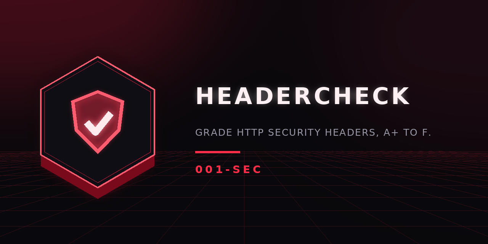

<p align="center">
  
</p>

# headercheck

**HTTP security header auditor with A+ to F grades.** Single file, Python 3 standard library only, zero dependencies.

<p>
  <a href="https://001-sec.github.io/headercheck/"></a>
  
  
  
</p>

> **Authorized use only.** Check only sites you own or are authorized to test. It is a verification instrument for defenders and learners, in the same category as open-source scanners and audit utilities.

## Quickstart

```bash
curl -O https://raw.githubusercontent.com/001-sec/headercheck/main/headercheck.py
python3 headercheck.py --help
```

Landing page: https://001-sec.github.io/headercheck/

Audits the HTTP security headers of any site you are authorized to test and grades them A+ to F, with concrete fix advice for every gap.

## Features
- Checks HSTS, Content-Security-Policy, X-Content-Type-Options, X-Frame-Options, Referrer-Policy, Permissions-Policy, COOP and CORP
- Flags information-leak headers (`Server`, `X-Powered-By`, framework version headers)
- Grade per header and overall percentage score; value validation (e.g. nosniff must be exact)
- Audit many URLs in one run; JSON report for tracking posture over time
- Exit code 0 only when the worst grade is B or better - drop it into CI

## Usage
```
python3 headercheck.py https://example.com
python3 headercheck.py https://app.example.com https://api.example.com -o posture.json
```

## Sample output
```
https://example.com  ->  HTTP 200  grade D (34%)
  [F] strict-transport-security          MISSING
       HSTS: forces HTTPS and blocks downgrade attacks. Add 'max-age=63072000; includeSubDomains; preload'.
  [leak] server: ECS (nyb/1D18)  (consider removing)
```

## License
MIT, see [LICENSE](LICENSE).

## Contributing

Issues and pull requests are welcome. Keep it dependency-free and single-file.

---

<p align="center">Built by <a href="https://github.com/001-sec">001-sec</a></p>
